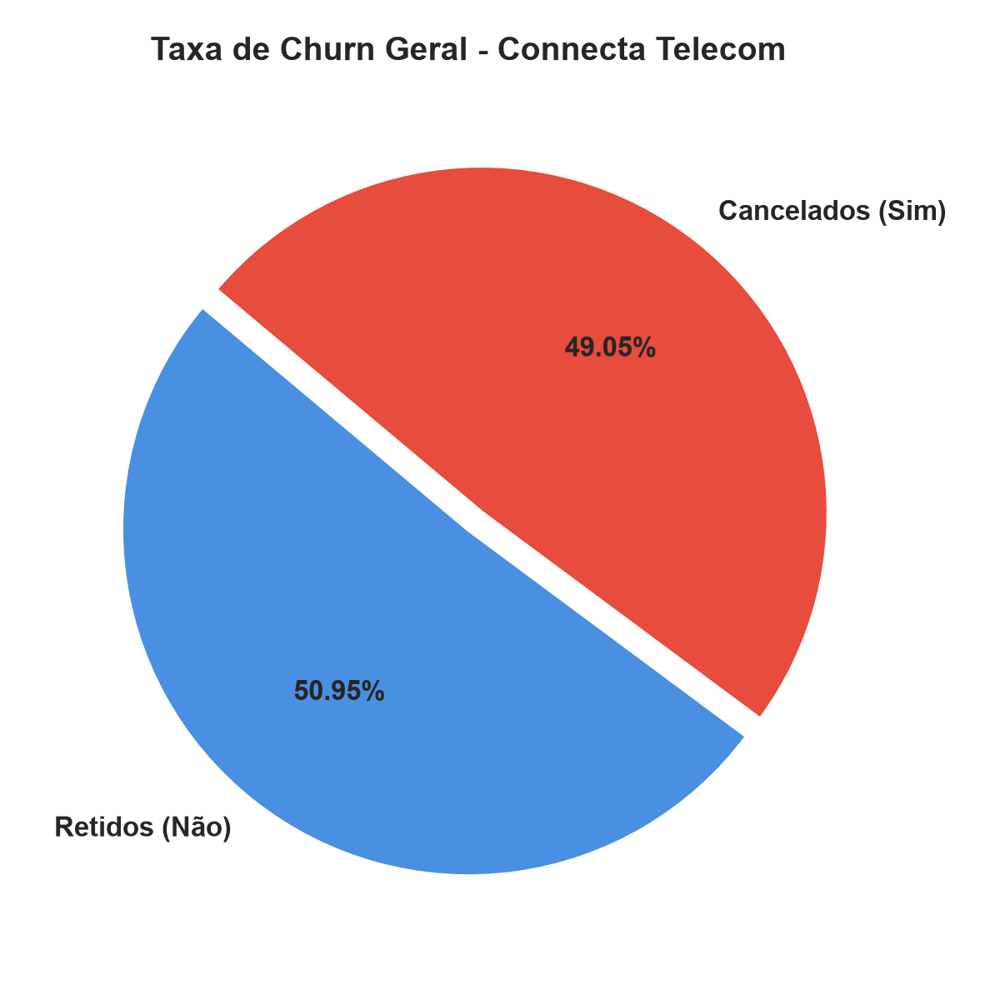
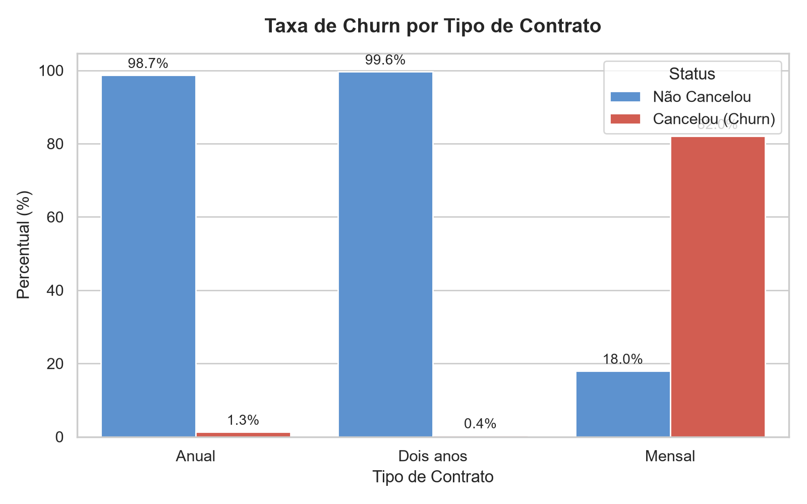
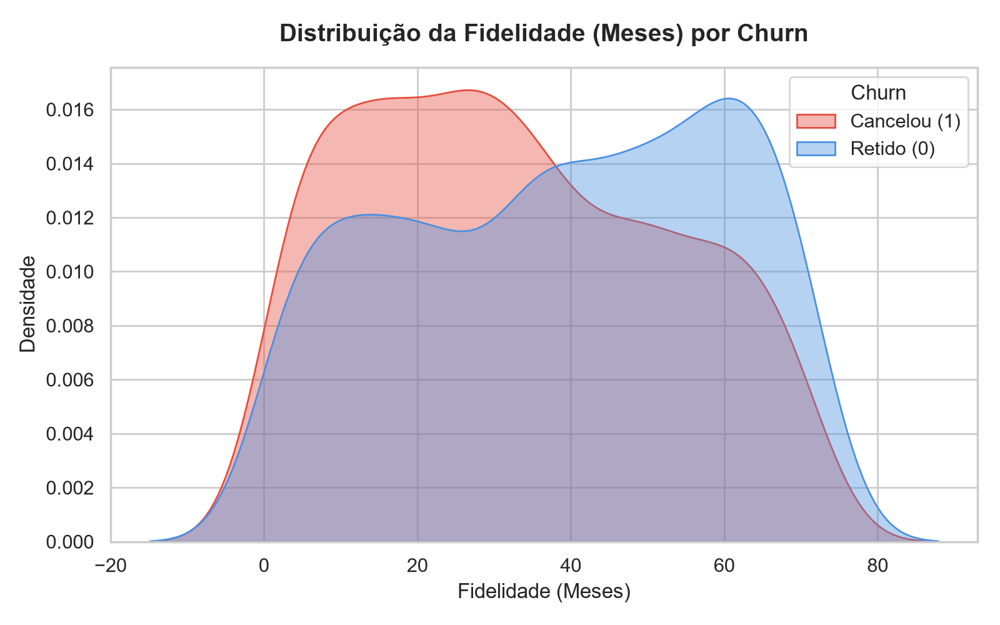
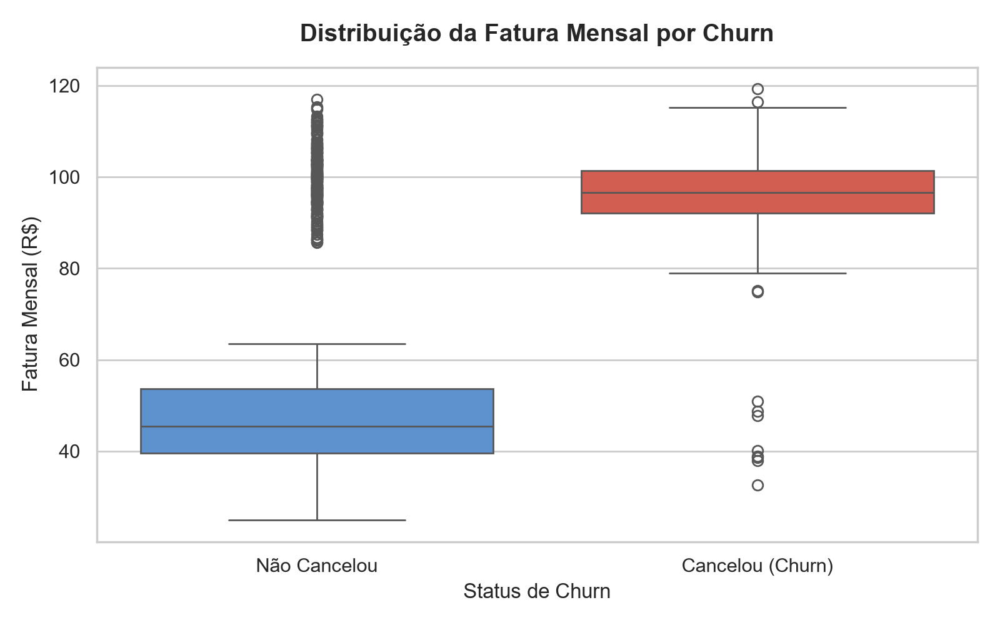

# 📊 Modelagem Estatística para Previsão e Interpretação de Churn
### **Connecta Telecom | Customer Retention & Statistical Analytics**


---

## 📌 Sumário Executivo

A **Connecta Telecom** enfrentava uma taxa histórica de cancelamento de serviços (**Churn**) de **49.05%**, comprometendo a receita recorrente e elevando os custos de aquisição de novos clientes (CAC).

Diferente de abordagens focadas apenas em algoritmos de *Machine Learning* "caixa-preta", este projeto utilizou **Modelagem Estatística Rigorosa (Regressão Logística via Statsmodels)** para responder à diretoria:
> *"Quais fatores têm impacto estatisticamente significante na decisão de cancelamento e qual a magnitude exata desse impacto para orientar ações de negócio?"*

### 🎯 Principais Destaques do Modelo
- **Acurácia Geral:** **90.00%**
- **Sensibilidade (Recall):** **95.31%** (identifica 95 de cada 100 clientes propensos ao churn)
- **Pseudo $R^2$ de McFadden:** **0.6451** (ajuste estatístico de alta qualidade)
- **Fator Crítico:** Clientes com **contrato mensal** têm um risco de cancelamento **≈ 195 vezes maior** do que clientes com contratos anuais.
- **Efeito Protetor:** Cada mês adicional de permanência reduz as chances de cancelamento em **≈ 5.4%**.

---

## 🏢 Contexto do Negócio & Definição do Problema

A retenção de clientes em telecomunicações é amplamente mais rentável do que a aquisição. O churn não ocorre de forma aleatória; ele reflete atritos no ciclo de vida do cliente, sensibilidade a preço e adequação de planos.

| Pergunta de Negócio | Abordagem Metodológica |
| :--- | :--- |
| **Compreender a relação entre variáveis explicativas e a decisão** | **Modelagem Estatística** (Interpretação de Coeficientes e Razão de Chances) |
| **Identificar clientes em iminência de cancelamento** | **Modelagem Preditiva** (Cálculo de Probabilidade Sigmoide com Limiar Decisório) |

---

## 📂 Estrutura do Repositório

```bash
connecta-telecom-churn/
│
├── data/
│   └── connecta_telecom_churn.csv        # Base de dados estruturada (2.000 clientes)
│
├── notebooks/
│   ├── connecta_telecom_churn_analysis.ipynb # Notebook com análise completa, EDA e modelagem
│   └── iframe_figures/                  # Gráficos interativos exportados via Plotly
│
├── src/
│   ├── __init__.py
│   ├── data_generator.py                 # Script modular de geração sintética da base
│   └── train_model.py                   # Script de treino, diagnóstico e avaliação estatística
│
├── assets/                               # Gráficos estáticos de alta resolução para documentação
│   ├── taxa_churn_geral.png
│   ├── churn_por_tipo_contrato.png
│   ├── distribuicao_fidelidade_churn.png
│   └── distribuicao_fatura_churn.png
│
├── .gitignore                            # Arquivos e diretórios ignorados pelo Git
├── requirements.txt                      # Dependências do projeto
├── LICENSE                               # Licença MIT
└── README.md                             # Documentação executiva e técnica do projeto
```

---

## 🧾 Dicionário de Dados

A base de dados é composta por **2.000 observações** e **6 variáveis** fundamentais:

| Variável | Tipo | Descrição |
| :--- | :--- | :--- |
| `ID_Cliente` | Numérico (Discreto) | Identificador único de cada cliente |
| `Fidelidade_Meses` | Numérico (Contínuo) | Tempo de relacionamento com a empresa (1 a 72 meses) |
| `Tipo_Contrato` | Categórico | Tipo de assinatura: `'Mensal'`, `'Anual'`, `'Dois anos'` |
| `Servico_Internet` | Categórico | Tecnologia contratada: `'Fibra Óptica'`, `'DSL'`, `'Não'` |
| `Fatura_Mensal` | Numérico (Contínuo) | Valor monetário médio da fatura mensal (R$ 20,00 a R$ 120,00) |
| `Churn` | Binário (Target) | Indicador de cancelamento: `0 = Não` (Retido), `1 = Sim` (Cancelou) |

---

## 📈 Análise Exploratória dos Dados (EDA)

### 1. Taxa Geral de Churn
A base apresenta **49.05% de churn** (distribuição equilibrada para calibragem de modelos binários):
<p align="center">
  
</p>

### 2. Churn por Tipo de Contrato
Diferença dramática entre contratos:
- Clientes com **contrato mensal** apresentam taxa de churn massiva (**> 75%**).
- Clientes com contrato de **dois anos** ou **anual** apresentam índices de cancelamento muito reduzidos.
<p align="center">
  
</p>

### 3. Distribuição de Fidelidade (em Meses)
Clientes que cancelam concentram-se fortemente nos **primeiros meses de assinatura**. Clientes com mais de 30 a 40 meses de relacionamento tornam-se extremamente resilientes.
<p align="center">
  
</p>

### 4. Impacto do Valor da Fatura Mensal
A mediana da fatura dos clientes que deram churn é sensivelmente superior à dos clientes retidos, evidenciando **sensibilidade a preço** e percepção de custo-benefício desfavorável.
<p align="center">
  
</p>

---

## 🔬 Metodologia Estatística

### Modelo: Regressão Logística (*Logit*)
Para analisar a probabilidade de um evento binário $P(Y=1|X)$, utilizamos a função de ligação *logit*:

$$\ln\left(\frac{P}{1 - P}\right) = \beta_0 + \beta_1 X_1 + \beta_2 X_2 + \dots + \beta_k X_k$$

Onde $\frac{P}{1 - P}$ é a **Razão de Chances (Odds)**.

### Categorias de Referência (*Dummy Encoding*)
Para evitar a armadilha da multicolinearidade perfeita (*Dummy Variable Trap*), foram fixadas categorias base:
- **`Tipo_Contrato`**: Categoria base = **`Anual`**
- **`Servico_Internet`**: Categoria base = **`DSL`**

---

## 📊 Resultados e Interpretação dos Coeficientes

Ajuste do modelo via **Máxima Verossimilhança (MLE)** no pacote `statsmodels`:

```text
                           Logit Regression Results                           
==============================================================================
Dep. Variable:                  Churn   No. Observations:                 2000
Model:                          Logit   Df Residuals:                     1993
Method:                           MLE   Df Model:                            6
Pseudo R-squ.:                  0.6451   Log-Likelihood:                -491.87
converged:                       True   LL-Null:                       -1385.9
Covariance Type:            nonrobust   LLR p-value:                     0.000
=================================================================================================
                                coef    std err          z      P>|z|      [0.025      0.975]
-------------------------------------------------------------------------------------------------
const                        -5.2266      0.714     -7.316      0.000      -6.627      -3.826
Fidelidade_Meses             -0.0556      0.006     -9.884      0.000      -0.067      -0.045
Fatura_Mensal                 0.0316      0.016      2.004      0.045       0.001       0.062
Tipo_Contrato_Dois anos      -1.2741      1.075     -1.185      0.236      -3.382       0.834
Tipo_Contrato_Mensal          5.2736      0.934      5.647      0.000       3.443       7.104
Servico_Internet_Fibra Óptica 1.4550      0.180      8.091      0.000       1.103       1.807
Servico_Internet_Não          0.2096      0.264      0.793      0.428      -0.308       0.727
=================================================================================================
```

### 🎲 Tabela de Razão de Chances (Odds Ratios) & Intervalos de Confiança (95%)

$$\text{Odds Ratio} = \exp(\beta)$$

| Variável | Coef ($\beta$) | Odds Ratio | IC 2.5% | IC 97.5% | p-valor | Interpretação para o Negócio |
| :--- | :---: | :---: | :---: | :---: | :---: | :--- |
| **`Tipo_Contrato_Mensal`** | `+5.2736` | **195.11** | 31.28 | 1216.86 | `< 0.001` | **Fator Crítico:** Clientes mensais têm probabilidade **195 vezes maior** de cancelar do que contratos anuais. |
| **`Servico_Internet_Fibra`**| `+1.4550` | **4.28** | 3.01 | 6.09 | `< 0.001` | Usuários de Fibra Óptica têm **4.28x mais chances** de churn do que DSL (possível insatisfação de serviço/instabilidade). |
| **`Fatura_Mensal`** | `+0.0316` | **1.03** | 1.00 | 1.06 | `0.045` | Cada **R$ 1,00 a mais** na fatura eleva em **≈ 3.2%** o risco de cancelamento. |
| **`Fidelidade_Meses`** | `-0.0556` | **0.95** | 0.94 | 0.96 | `< 0.001` | **Fator Protetor:** Cada mês adicional reduz o risco de cancelamento em **≈ 5.4%** (`1 - 0.946`). |
| `Tipo_Contrato_Dois anos` | `-1.2741` | `0.28` | 0.03 | 2.30 | `0.236` | Reduz chance de churn, porém estatisticamente colinear quando comparado ao grupo base anual. |
| `Servico_Internet_Não` | `+0.2096` | `1.23` | 0.73 | 2.07 | `0.428` | Intervalo contém 1.0 (efeito estatisticamente nulo). |

---

## 🎯 Avaliação de Desempenho Preditivo

Para um corte padrão de probabilidade de $50\%$ ($\text{Threshold} = 0.50$):

```text
Verdadeiros Negativos (TN):  865  |  Falsos Positivos   (FP):  154
Falsos Negativos       (FN):   46  |  Verdadeiros Positivos (TP):  935
-----------------------------------------------------------------
• Acurácia Geral          : 90.00%
• Precisão                : 85.86%
• Recall / Sensibilidade  : 95.31% (935 detectados de 981 reais)
• F1-Score                : 90.34%
• Pseudo R² (McFadden)    : 0.6451
• AIC                     : 997.73
```

---

## 💡 Recomendações Estratégicas para o Negócio

Com base nas evidências estatísticas, foram desenhadas 4 ações prioritárias para a equipe de CRM e Retenção:

| # | Recomendação Estratégica | Evidência Estatística | Plano de Ação Prático |
| :---: | :--- | :--- | :--- |
| **1** | **Campanha de Migração de Contratos** | Contrato mensal possui **Odds Ratio = 195.11**. | Ofertar benefícios concretos (ex: primeiro mês grátis, upgrade de franquia ou descontos escalonados) para clientes mensais migrarem para planos anuais. |
| **2** | **Onboarding Crítico nos Primeiros 6 Meses** | Fidelidade reduz o churn em **5.4% ao mês**. | Os primeiros meses são o ponto de maior risco de abandono. Implementar suporte proativo, canal exclusivo no primeiro trimestre e checagem de satisfação (*CSAT*) aos 30 e 90 dias. |
| **3** | **Auditoria de Qualidade na Fibra Óptica** | Fibra Óptica tem **4.28x mais chances** de churn em relação ao DSL. | Mapear chamados técnicos e instabilidades na rede de fibra. Clientes de fibra costumam ser mais exigentes e pagam mais caro; falhas técnicas geram cancelamento imediato. |
| **4** | **Revisão de Pacotes de Alto Ticket** | Faturas maiores aumentam o churn em **3.2% a cada R$ 1,00**. | Para clientes com faturas superiores a R$ 90,00, ofertar serviços de valor agregado (SVAs como streaming ou suporte prioritário) para elevar a percepção de valor sobre o preço pago. |

---

## 🚀 Como Executar o Projeto Localmente

### 1. Pré-requisitos
- Python 3.10+ instalado
- Git instalado

### 2. Clonar o Repositório
```bash
git clone https://github.com/Edson-Alves-Git/connecta-telecom-churn.git
cd connecta-telecom-churn
```

### 3. Criar e Ativar Ambiente Virtual
```bash
# Windows
python -m venv venv
venv\Scripts\activate

# Linux / MacOS
python3 -m venv venv
source venv/bin/activate
```

### 4. Instalar as Dependências
```bash
pip install -r requirements.txt
```

### 5. Executar os Scripts ou o Notebook
```bash
# Executar script de modelagem estatística diretamente no terminal
python src/train_model.py

# Ou abrir o Jupyter Lab / Notebook interativo
jupyter lab notebooks/connecta_telecom_churn_analysis.ipynb
```

---

## 🛠️ Tecnologias e Ferramentas

- **Linguagem:** [Python](https://www.python.org/)
- **Manipulação de Dados:** [Pandas](https://pandas.pydata.org/), [NumPy](https://numpy.org/)
- **Modelagem Estatística:** [Statsmodels](https://www.statsmodels.org/)
- **Visualização de Dados:** [Matplotlib](https://matplotlib.org/), [Seaborn](https://seaborn.pydata.org/), [Plotly](https://plotly.com/)
- **Ambiente de Desenvolvimento:** Jupyter Notebook / Visual Studio Code

---

## 📜 Licença

Distribuído sob a licença **MIT**. Consulte o arquivo [LICENSE](LICENSE) para mais detalhes.

---
*Projeto desenvolvido com foco em Ciência de Dados aplicada a Negócios e Modelagem Estatística Avançada.*


## 👤 Autor

Desenvolvido por **[Edson Alves](https://github.com/Edson-Alves-Git)**.

